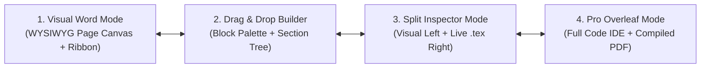
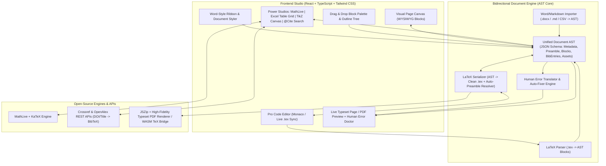

# OmniTeX Studio: Complete Product Plan & System Architecture
**"The Power of LaTeX. The Simplicity of Microsoft Word, Notion & Canva."**

---

## 1. Executive Vision
**OmniTeX Studio** is an all-in-one, open-source-powered visual LaTeX authoring platform designed so that **anyone who has used Microsoft Word can create publication-ready academic papers, theses, resumes, and presentations in minutes—without knowing a single LaTeX command**, while still generating **100% clean, standard, Overleaf- and ArXiv-compatible `.tex` code** under the hood.

### How It Solves Every LaTeX Pain Point
| Traditional LaTeX Pain | How OmniTeX Studio Solves It |
| :--- | :--- |
| **100 lines of scary `\usepackage` preamble** | **Visual Document Styler & Ribbon:** Pick templates, margins, fonts, columns, and headers via sliders and dropdowns. Packages are managed 100% automatically. |
| **Writing `\section{}`, `\textbf{}`, `\begin{itemize}`** | **Word Ribbon + Drag-and-Drop Block Canvas:** Add sections, drag-and-drop reorder them, or type `/` (like Notion) to insert any element visually. |
| **Memorizing `\frac{a}{b}`, `\int_0^\infty`, `\mathbb{R}`** | **Visual Math Studio:** Type naturally inside a live visual equation box (**MathLive**), click buttons on a categorized math keyboard, **draw a symbol with your mouse**, or paste a screenshot of an equation. |
| **Painful `& & \\ \hline` tables** | **Excel-Like Visual Table Grid:** Paste from Excel/Google Sheets, merge cells with one click, toggle `booktabs` academic borders, and auto-fit wide tables to page margins. |
| **Images floating away to random pages** | **Visual Figure Card:** Drag-and-drop images, drag a width slider (`10%–100%`), build `(a) (b) (c)` subfigure grids visually, and click **"Pin Exactly Here `[H]`"** so images stay where you put them. |
| **Coding TikZ coordinates by hand** | **Canva-Like Visual Diagram & Plot Studio:** Drag-and-drop boxes, arrows, flowcharts, and plots on a visual canvas that auto-compiles to native `tikz` and `pgfplots` code. |
| **Managing `.bib` files and `\cite{...}` keys** | **Smart `@Citation` Search:** Type `@` and search any paper by **Title, DOI, or ArXiv URL** (live Crossref/OpenAlex lookup). Auto-builds `references.bib` and inserts visual citation pills. |
| **Cryptic compiler errors (`Missing $ inserted`)** | **Human Error Translator & Auto-Doctor:** Explains every issue in plain English with a **1-Click "Fix It For Me"** button and auto-escapes special characters (`%`, `&`, `_`, `#`). |

---

## 2. User Experience (UX) & The 4 Seamless Modes

Users can switch between **4 synchronized modes** at any time with a single click in the top bar:

### Mode 1: Visual "Word / Page" Mode (Default for Beginners)
* Looks and feels like **Microsoft Word + Notion**.
* Displays a realistic **paginated paper sheet** (A4 or US Letter, 1-column or 2-column) with real margins, page headers/footers, and automatic numbering for Sections (`1`, `1.1`), Figures (`Figure 1`), Tables (`Table 1`), and Equations (`(1)`).
* **Zero LaTeX backslashes visible.** Formatting is done via the top **Word-style Ribbon Toolbar**, floating text selection toolbar, or `/` slash commands.

### Mode 2: Drag-and-Drop Block & Section Builder
* **Left Sidebar — Visual Component Palette:** Users can literally drag blocks from the sidebar and drop them anywhere on the page:
  * **Structure Blocks:** Section, Subsection, Abstract, Two-Column Layout, Page Break, Appendix, Table of Contents, Cover/Title Page.
  * **Math & Science Blocks:** Visual Equation, Multi-line Aligned Equation, Matrix Grid, Piecewise Function (`cases`), Chemical Formula (`mhchem`).
  * **Data & Media Blocks:** Excel Table Grid, Single Figure, Multi-Image Subfigure Grid (`2x2`, `1x3`), TikZ Flowchart/Diagram, PGFPlots Chart.
  * **Academic Special Blocks:** Theorem / Lemma / Proof Box, Colored Callout Box (`tcolorbox`), Pseudocode Algorithm (`algorithm2e`), Syntax-Highlighted Code Block (`listings`).
* **Interactive Outline Tree:** Drag-and-drop whole sections in the sidebar to reorder chapters and subsections—all paragraphs, figures, and subsections inside move with it automatically!

### Mode 3: Split "Learn-As-You-Go" Inspector Mode
* Left side: The interactive Visual Word/Block Editor.
* Right side: **Live Synchronized `.tex` Code** with bidirectional highlighting.
* When a user clicks a visual table or equation on the left, the exact `\begin{table}...\end{table}` block highlights on the right. Editing either side updates the other in real time!

### Mode 4: Pro Overleaf Mode (Code + PDF Preview)
* Full **Monaco Editor** (VS Code engine) with LaTeX syntax highlighting, autocomplete, snippet wizards, and multi-file tree (`main.tex`, `references.bib`, `figures/`).
* Side-by-side **Live PDF Preview** with SyncTeX (click PDF $\leftrightarrow$ jump to `.tex` line).

---

## 3. Complete Feature Breakdown (All 10 Integrated Modules)

### Module 1: Word-Style Ribbon & Visual Document Styler (Preamble-Free Setup)
* **1-Click Template Gallery:**
  * *IEEE Double-Column Conference Paper*
  * *ACM / Springer Academic Article*
  * *University Thesis / Dissertation (with Cover Page & TOC)*
  * *Modern Academic CV / Resume*
  * *Homework / Lab Report*
  * *Beamer Presentation Slides*
  * *Formal Letter / Cover Letter*
* **Page Layout Controls (Auto-generates `geometry`, `setspace`, `fontspec`/`babel`):**
  * Paper Size (`A4`, `Letter`, `Legal`, `Beamer 16:9`)
  * Visual Margin Presets (*Normal 1"* , *Narrow 0.5"*, *Wide*, or custom sliders)
  * Columns (`1 Column`, `2 Columns` with column gap slider)
  * Font Family (*Computer Modern (Classic LaTeX)*, *Times New Roman (`newtx`)*, *Palatino (`mathpazo`)*, *Helvetica (Sans)*, *Garamond*)
  * Font Size (`10pt`, `11pt`, `12pt`) & Line Spacing (`1.0`, `1.15`, `1.5`, `2.0`)
* **Visual Header & Footer Designer (`fancyhdr`):**
  * Three visual boxes for Top Header (Left, Center, Right) and Bottom Footer (Left, Center, Right). Drop pills like `[Page #]`, `[Total Pages]`, `[Section Title]`, `[Author Name]`, `[Date]`, and toggle header/footer horizontal rule lines.

### Module 2: Visual Math & Equation Studio
* **Live WYSIWYG Math Input (`MathLive` Integration):**
  * Click inside any inline `$...$` or display equation block to open a rich visual math editor with a categorized **On-Screen Virtual Math Keyboard** (*Basic, Calculus, Matrices, Greek, Set Theory, Logic, Physics, Arrows*).
* **Visual Matrix & Piecewise Wizard:**
  * Choose rows $\times$ columns (e.g., $3 \times 3$), bracket style (`( )`, `[ ]`, `| |`, `|| ||`), or fill options (Identity matrix, Zero matrix, Diagonal dots `\ddots`) inside an interactive grid.
* **Draw-to-LaTeX Symbol & Formula Pad:**
  * Built-in handwriting/mouse drawing canvas to sketch any unfamiliar symbol (Detexify-style) or equation and insert it with one click.
* **Equation Library & Favorites:**
  * 1-click insert for common formulas (Quadratic Formula, Gaussian Distribution, Euler's Identity, Fourier Transform, Maxwell's Equations, Cross-Entropy Loss, Softmax, etc.).

### Module 3: Visual Spreadsheet Table Studio
* **Interactive Grid Editor:**
  * Add/delete rows and columns, resize, align left/center/right per column, format cell text (bold, italic, inline math, background color, text color).
* **Excel / Google Sheets / CSV Paste & Import:**
  * Copy any cell range from Excel or Google Sheets and paste directly—automatically builds the grid!
* **Cell Merging & Borders:**
  * Select multiple cells and click **"Merge Cells"** $\rightarrow$ automatically computes `\multicolumn` and `\multirow`!
* **Academic Table Themes:**
  * 1-click presets: **Booktabs Publication Style** (`\toprule`, `\midrule`, `\bottomrule`—no ugly vertical lines), **Grid Style**, **Zebra Striped Rows** (`\rowcolors`), and **Auto-Shrink to Page Width** (`\resizebox{\textwidth}{!}{...}`).

### Module 4: Smart Figure, Subfigure & Float Manager
* **Drag-and-Drop Asset Manager:** Drop images into the document or media library.
* **Visual Controls:**
  * Width slider (`10%` to `100%` of `\textwidth`), alignment (`Left`, `Center`, `Right`), border frame toggle, and rotation.
  * **Plain-English Float Placement Selector:**
    * 📌 **Lock Exact Position Here** (`[H]` via `float` package — works like Word!)
    * ⬆️ **Top of Page** (`[t!]`)
    * ⬇️ **Bottom of Page** (`[b!]`)
    * ↔️ **Span Across Both Columns** (`\begin{figure*}`)
* **Subfigure Grid Builder:**
  * Switch any figure block into a **Multi-Image Grid** (2 side-by-side, 3 in a row, $2\times 2$ grid). Each sub-image gets its own individual sub-caption `(a)`, `(b)`, `(c)` and label, plus a main figure caption!

### Module 5: Visual Diagram, Flowchart & Plot Studio (TikZ + PGFPlots)
* **Visual TikZ Diagram Canvas:**
  * Interactive node-and-edge canvas where users drag rectangles, circles, diamonds, cylinders (databases), and text nodes, connect them with straight/curved/dashed arrows, pick colors, and snap to a grid.
  * Real-time compiler converts the visual canvas into 100% native `\begin{tikzpicture}...\end{tikzpicture}` code!
* **Visual Chart & Function Plotter (`PGFPlots`):**
  * **Function Plotter:** Enter math functions (e.g., `sin(deg(x))`, `x^2 - 4`), set X/Y axis labels, domain, legend position, and grid style $\rightarrow$ outputs clean `pgfplots` LaTeX code.
  * **Data Chart Builder:** Enter or paste X/Y data points to generate native LaTeX Line, Bar, or Scatter plots.

### Module 6: Smart Citations (`@`) & Cross-References (`#`)
* **Live Academic Search Engine (Crossref + OpenAlex + ArXiv APIs):**
  * Search by **Paper Title, Author, DOI (`10.1038/...`), or ArXiv ID (`2305.xxxx`)** right inside the app—no need to open Google Scholar!
  * One click adds the full BibTeX entry to `references.bib` and inserts a visual citation pill `[Author, Year]` into your sentence.
* **BibTeX Importer & Cleaner:**
  * Paste raw BibTeX or upload a `.bib` file $\rightarrow$ auto-formats, deduplicates, and fixes missing fields.
* **Visual Cross-Reference Linker (`#`):**
  * Type `#` or click **"Insert Reference"** to see a dropdown of every Section, Figure, Table, and Equation in your document. Inserts a smart pill (`Figure 2`, `Table 1`, `Equation (3)`) backed by `\autoref{...}` / `\cref{...}`.

### Module 7: Academic Power Blocks (Theorems, Algorithms, Code, CV)
* **Theorem / Callout Designer:** Choose block type (*Theorem, Lemma, Proposition, Corollary, Definition, Example, Proof, Note, Warning*), pick a visual style (*Classic Italic*, *Framed Box*, *Colored Left-Bar (`tcolorbox`)*), and type inside.
* **Visual Algorithm Builder:** Build clean academic pseudocode (`Input:`, `Output:`, `For`, `While`, `If/Else`, `Return`) with visual step indentation that outputs `\begin{algorithm}...\end{algorithm}`.
* **Code Listing Block:** Paste code, pick language (Python, C++, Java, R, MATLAB, SQL), toggle line numbers and frame $\rightarrow$ outputs `listings` / `minted` LaTeX.

### Module 8: Universal Import / Export Converter
* **Import `.docx` (Microsoft Word), `.md` (Markdown), or existing `.tex`:**
  * Drop a Word `.docx` file (via `mammoth.js` + custom DOM-to-Block AST converter) or paste rich text from Word/Google Docs $\rightarrow$ converts headings, bold/italic, bullet lists, tables, and images directly into editable OmniTeX visual blocks!
  * Paste or upload an existing `.tex` file $\rightarrow$ parses the preamble, sections, tables, figures, and equations into the visual editor!
* **1-Click Export:**
  * **Complete LaTeX Project (`.zip`):** Includes cleanly formatted `main.tex`, `references.bib`, and all uploaded `figures/` (ready to upload straight to Overleaf or ArXiv!).
  * **Standalone `.tex` File** & ** `.bib` File**
  * **Print-Ready PDF** (via instant high-precision preview & compilation engine)
  * **Microsoft Word (`.docx`) / HTML Export**

### Module 9: "Human Error Translator" & Package Auto-Doctor
* **Real-Time Linter & Auto-Fixer:**
  * Detects common mistakes before compilation (unescaped `%`, `&`, `_`, `#`, unmatched braces, missing labels, wide tables, missing captions) and shows a friendly card:
    * **What happened** (in plain English, zero jargon)
    * **Why it matters**
    * **[Fix Automatically]** button that patches the document in 1 click.
* **Automatic Preamble Manager:**
  * Tracks which blocks exist in your document and automatically injects only the exact required `\usepackage{...}` declarations (`amsmath`, `graphicx`, `booktabs`, `multirow`, `tikz`, `pgfplots`, `tcolorbox`, `algorithm2e`, `hyperref`, `cleveref`) in the correct load order (e.g., always loading `hyperref` and `cleveref` last!).

---

## 4. Technical Architecture

### Core Data Architecture: The Bidirectional Document AST
The secret to making a visual editor that **never corrupts LaTeX** and keeps **Visual Mode** and **Code Mode** 100% synchronized is a **Unified Document AST (Abstract Syntax Tree)**:

1. **Document Config (`documentConfig`):**
   * Stores template ID (`ieee`, `article`, `report`, `beamer`, `cv`), document class options (`11pt`, `twocolumn`, `a4paper`), margins, font package, line spacing, header/footer slots, title, authors, affiliations, and date.
2. **Block Array (`blocks: DocumentBlock[]`):**
   * Every element in the document is a strongly-typed block with a unique `id`:
     * `heading` (`level: 1 | 2 | 3`, `title`, `numbered`, `label`)
     * `abstract` (`content`)
     * `paragraph` (rich inline tokens: bold, italic, underline, color, inline math `$...$`, citation pill `\cite{}`, cross-ref pill `\autoref{}`, footnote `\footnote{}`)
     * `list` (`ordered` / `unordered`, nested items)
     * `equation` (`latex`, `numbered`, `label`, `mode: 'single' | 'align' | 'matrix' | 'cases'`)
     * `table` (`rows[][]`, `merges[]`, `alignments[]`, `theme: 'booktabs' | 'grid' | 'striped'`, `caption`, `label`, `autoFitWidth`)
     * `figure` (`images[]`, `layout: 'single' | 'grid-2' | 'grid-3' | 'grid-2x2'`, `widthPercent`, `placement: 'H' | 't' | 'b' | 'star'`, `caption`, `label`)
     * `diagram` (`diagramType: 'tikz-flow' | 'pgfplot'`, `nodes[]`, `edges[]`, `plotConfig`, `generatedTikz`, `caption`, `label`)
     * `callout` (`boxType: 'theorem' | 'lemma' | 'proof' | 'definition' | 'note' | 'warning'`, `title`, `content`, `color`)
     * `algorithm` (`title`, `inputs`, `outputs`, `steps[]`, `label`)
     * `code` (`language`, `code`, `caption`, `lineNumbers`)
     * `raw_latex` (fallback block for any custom user LaTeX macro so nothing is ever lost!)
3. **Bibliography Store (`bibliography: BibEntry[]`):**
   * Structured `.bib` items (`id`, `type`, `title`, `author`, `year`, `journal`, `doi`, `url`) with automatic `.bib` file generation.
4. **Auto-Preamble Resolver (`resolvePreamble(config, blocks)`):**
   * Inspects `config` and `blocks` and deterministically outputs a clean, commented LaTeX preamble with zero duplicate or conflicting packages.

---

## 5. Phased Implementation Plan

We can build the entire **OmniTeX Studio** right here in `c:\Users\User\Downloads\Overleaf` as a sleek, zero-setup web application (React + TypeScript + Vite + Tailwind CSS + Lucide Icons + KaTeX + MathLive + Monaco/Code Editor + JSZip + Mammoth `.docx` importer):

1. **Phase 1: Core Architecture, Bidirectional AST $\leftrightarrow$ LaTeX Engine & Template System**
   * Build the unified Document AST, Auto-Preamble Resolver, `.tex` Serializer, `.tex` Importer/Parser, `.bib` Generator, and 7 built-in Document Templates (IEEE 2-Column, Academic Article, University Thesis, Lab Report, Beamer Slides, Academic CV, Blank Word-Style Doc).
2. **Phase 2: The 4-Mode Studio Workspace, Word Ribbon & Drag-and-Drop Block Canvas**
   * Build the top **Word-Style Ribbon** (Home, Insert, Page Layout, References, Design, Doctor/Export), **4-Mode Switcher** (*Visual Word Mode*, *Drag & Drop Builder*, *Split Inspector*, *Pro Code Mode*), Left **Drag-and-Drop Block Palette + Section Outline Tree**, and the **Paginated Visual Paper Canvas**.
3. **Phase 3: The 4 Interactive Power Studios (Math, Excel Tables, TikZ Diagrams, Smart Citations)**
   * **Visual Math Studio:** Interactive equation builder with categorized symbol palettes, visual Matrix/Cases generator, Formula Library, and Draw-to-Symbol canvas.
   * **Visual Table Studio:** Excel-like interactive spreadsheet grid with CSV/TSV paste, cell merging, `booktabs` styling, and auto-width fit.
   * **Visual TikZ & Plot Studio:** Drag-and-drop node/arrow diagram builder + function/data plotter (`pgfplots`) that compiles live to SVG preview and native TikZ code.
   * **Smart `@Citation` & `#Cross-Ref` Manager:** Live Crossref/OpenAlex API search by Title/DOI + visual cross-reference linker.
4. **Phase 4: Word (`.docx`) Importer, Human Error Translator & 1-Click Project/PDF Export**
   * Build the `.docx` / `.md` / `.tex` drag-and-drop importer, the **Human Error Translator & Auto-Fixer**, and 1-click export to **Overleaf-ready `.zip`**, `.tex`, `.bib`, and **Print-Ready Typeset PDF**.
